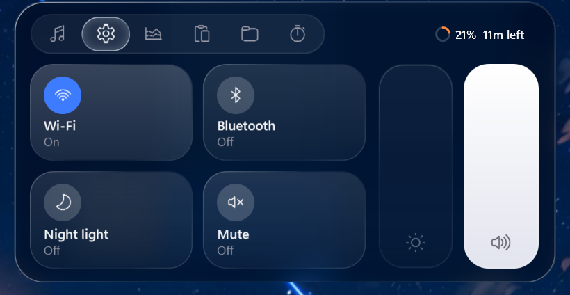
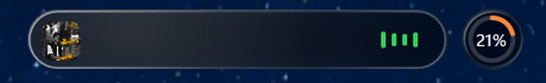
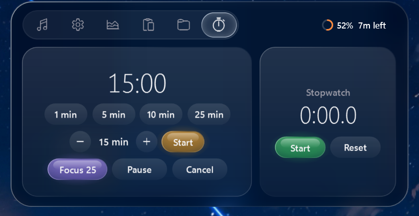
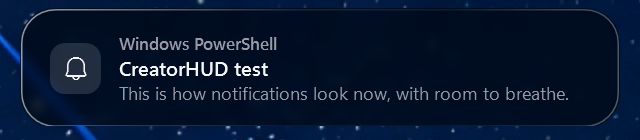

# CreatorHUD

**A liquid glass Dynamic Island for Windows 11, made for creators.**

CreatorHUD sits at the top of your screen as a thin line. Hover it and it opens into a glass panel with your music, quick controls, live stats, clipboard history, a file shelf and a timer. While Blender renders, a small glass bubble shows the progress next to the island.

It's a fork of [WinUltra](https://github.com/Gxmi2006/WinUltra) by **Gamindu Sasmitha**, rebuilt around a live liquid glass look.

---

## Install

1. Go to [**Releases**](../../releases/latest) and download **CreatorHUD.zip**.
2. Extract it anywhere, for example `Documents\CreatorHUD`, and run **CreatorHUD.exe**.
3. Windows will probably say *"Windows protected your PC"*, because the app isn't code-signed. Click **More info**, then **Run anyway**. You only see this once.
4. A short setup window lets you choose what to turn on: start with Windows, clipboard history, notification pop-ups and so on. Change these later from the tray icon.

**Requirements:** Windows 11, 64-bit. Nothing else to install, since everything it uses ships with Windows. No admin rights needed.

**Uninstall:** right-click the tray icon, choose **Remove CreatorHUD...**, then delete the folder.

---

## What's in it

**Resting pill.** When something is live (music, a timer, a render, charging), the line becomes a pill of dark tinted glass with a soft glow taken from the album art. With nothing going on, it's a solid dark grey line. Push your mouse to the top edge of the screen above it and it opens. Passing just below or beside it doesn't.

**Music vs videos.** When music is playing (Spotify, Apple Music, YouTube Music and the like), the resting island shows the album art and a little audio visualizer. Videos (YouTube, Instagram, Netflix...) leave it resting as a thin line. Hover and the Media tab still has their controls.

**Render bubble (Blender).** While Blender renders, a glass bubble buds off the island with a progress ring and the percentage. It counts frames for animations and samples for stills. When the render finishes, a quiet "Render done" pop-up shows the file name and how long it took. See [Blender add-on](#blender-add-on).

**Open panel.** Six tabs: Media, Controls, Stats, Clipboard, Shelf and Timer.

- **Live liquid glass.** The panel shows what's behind it in real time, frosted, with a bright rim and light bending at the edges. The tint adapts: lighter over dark wallpaper, darker over bright windows so text stays readable.
- **Glass tab capsule.** Click a tab and a glass capsule glides to it on a spring, stretching like a drop and magnifying the icons it passes over.
- **Jelly sliders.** Volume and brightness squish when pressed, lean when dragged fast and stretch like rubber past their ends.
- **Song scrubbing.** Drag the progress bar (or click anywhere on it) to jump in Spotify, a YouTube tab or any player that allows it. It goes through Windows' own media controls.
- **Tinted glass buttons, glass cards** and the rest of the inside are styled to match.

**Clipboard.** Everything you copy, text and images, lands in the Clipboard tab. Click a card to copy it again, pin the ones you use often, or remove them with ×. Nothing drops off the list on its own, however much you copy. Long lists load in batches of 60 with a **Show more** button so the tab stays smooth, and images are kept on disk with only small previews in memory.

**Shelf.** Drop files, folders or apps onto the island to park them on the shelf, then drag them out wherever you need them. They stay on the shelf after you drag them out, so you can use them again. Pin one to turn it into a one-click launch tile. **Clear unpinned** empties the rest.

**How long the clipboard and shelf last.** Everything on them, pinned items included, stays until you restart your PC, quit CreatorHUD from the tray, or clear it yourself. While the app runs, the lists are also saved to disk, so if CreatorHUD ever crashes and you open it again, nothing is lost.

**Notifications.** Windows notifications appear in the island as soft rounded cards with the app's own icon. This works for Store apps and ordinary programs like Discord.

**Screen recording.** By default the island hides itself from screenshots and screen recordings, so notifications never end up in your videos. Turn on **Show in screenshots and recordings** in Settings or the tray menu when you want it in a video. It keeps its glass look there too.

---

## Blender add-on

The render bubble needs a tiny add-on that tells CreatorHUD how far a render has got.

1. Download `blender/creator_hud_bridge.py` from this repo.
2. In Blender: **Edit → Preferences → Add-ons**, click the **⌄** menu at the top right and choose **Install from Disk...**, then pick the file.
3. Tick **CreatorHUD Bridge** to enable it.

It works with F12 stills, Ctrl+F12 animations and command-line renders, in Cycles and EEVEE. It only writes a small status file to `%LOCALAPPDATA%\WinUltra\render.json`, nothing else.

---

## Tray menu and settings

Right-click the tray icon for:

- **Open island** (or press **Ctrl+Alt+Space** anywhere)
- **Clipboard history**, **Notification pop-ups**, **Frosted glass**, **Caps Lock pop-up**
- **Show in screenshots and recordings**
- **Blender render progress.** Turns the render bubble on or off. When it's off, CreatorHUD stops watching for renders completely.
- **Start when I sign in**, **Settings...**, **Open data folder**, **Quit**, **Remove**

The clipboard list opens with **Win+Shift+V**, or **Ctrl+Alt+Shift+V** if Windows already uses that.

---

## Privacy

- CreatorHUD has **no network code**. It never connects to the internet.
- Clipboard history and the shelf stay on your PC, in `%LOCALAPPDATA%\WinUltra`, and only for the current session. They're deleted when you quit CreatorHUD and wiped when Windows restarts. Copies from password managers are skipped.
- For the glass look it reads the small strip of screen directly behind the island, in memory only. Nothing is saved or sent anywhere.
- It doesn't read your keyboard.

---

## Build it yourself

You don't need Visual Studio or the Windows SDK.

1. Download or clone this repo.
2. Double-click **`Build.cmd`**.

It compiles `CreatorHUD.exe` with the C# compiler that ships with Windows (.NET Framework 4.8), against the Windows metadata already in `System32`. The glass shaders are compiled at first run with Windows' own `d3dcompiler_47.dll` and cached.

### How the code is laid out

| File | What's in it |
|---|---|
| `src/WinUltra.cs` | Start-up, settings, tray menu, single-instance handling |
| `src/Island.cs` | The island: states and animations, all tabs, media, notifications, clipboard, shelf, timer |
| `src/Glass.cs` | Liquid glass: live screen capture and blur, the glass and tab-lens pixel shaders, the progress ring, jelly sliders, app icons |
| `src/RenderWatch.cs` | Reads the Blender add-on's status file |
| `src/WinRT.cs` | Small helpers so the Windows APIs work without the SDK |
| `src/Setup.cs` | The setup and settings window |
| `blender/creator_hud_bridge.py` | The Blender add-on |

---

## Changelog

**1.0.1**
- Fixed: the island could flash ghost copies of itself for a single frame while opening or closing. It's back on the steady window type.
- The resting music pill and visualizer only show for music (Spotify, Apple Music, YouTube Music...). YouTube, Instagram and other videos leave the island resting; their controls are still in the Media tab.
- Clipboard and shelf last for the whole session, pinned items included: no 30-item limit, and shelf files stay after you drag them out. They clear when the PC restarts, when you quit from the tray, or with Clear. Crash-safe saving with a backup copy.
- The hover area only reaches up to the screen edge above the island, not out to its sides or below, so it no longer opens when you're just passing by.
- The Shelf tab's drop card and the Clipboard list are ready the moment you open them, instead of popping in a moment later.
- Shelf has a **Clear unpinned** button. Long clipboard lists load in batches for smooth scrolling.
- New **Blender render progress** toggle in Settings and the tray menu.

**1.0.0**
- First release: the liquid glass redesign, gliding tab capsule, jelly sliders, song scrubbing, Blender render bubble, recording-friendly glass, new notification cards and performance work.

---

## Credits

- **[WinUltra](https://github.com/Gxmi2006/WinUltra) by Gamindu Sasmitha:** the original app and its core functionality. That covers the island, media and system controls, stats, clipboard, shelf, timer, notifications and the overall structure. Thank you for building it and for open-sourcing it.
- **CreatorHUD by Eshan ([Vyra Innovations](https://vyrainnovations.com)), built with Claude (Anthropic):** the liquid glass redesign and the new features. That includes live glass, the gliding tab capsule, jelly sliders, song scrubbing, the Blender render bubble, recording-friendly glass, the new notification cards, tinted glass buttons and the performance work.

## License

[MIT](LICENSE). Keep the license file, with both copyright lines, in any copy you share.
